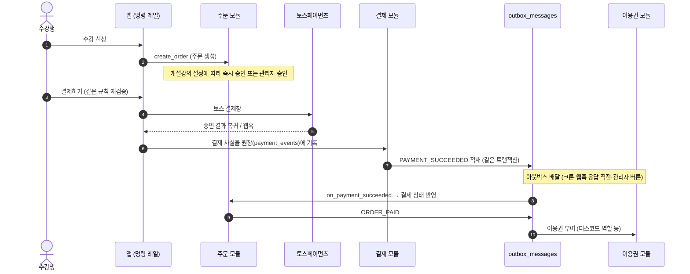

# class-desk 시스템 개요

> 1인 강사를 위한 수강생·결제·수강권 관리 서비스의 구조를 설명합니다.
> 핵심 설계: 데이터 무결성 우선, 5개 업무 모듈의 테이블 소유권 분리, 트랜잭셔널 아웃박스 기반 모듈 간 통신.

## 1. 모듈 경계와 계층

현재는 강사 1인이 쓰는 규모지만, 나중에 서비스를 키울 때 구조를 뜯어고치지 않도록 모듈 경계를 미리 나눴습니다. 폴더·테이블 소유권·경계 테스트로 나눈 것이며, 서비스를 물리적으로 분리한 것은 아닙니다.

```mermaid
flowchart TB
  subgraph entry [진입 계층]
    Browser[웹 브라우저]
    App["Next.js App Router (app/**)"]
    Proxy["인증·약관 확인 (proxy.ts)"]
  end

  subgraph cs [CS 및 횡단 관심사]
    CmdRail["명령/조회 레일 (lib/commands)"]
    Guards["무결성 가드 (lib/guards)"]
    OutboxDrain["아웃박스 배달 (lib/outbox/drain.ts)"]
  end

  subgraph modules [업무 모듈 5개 (테이블 소유권 분리)]
    Member["회원"]
    Order["주문"]
    Payment["결제"]
    Entitlement["이용권"]
    CSMod["CS"]
  end

  subgraph data [PostgreSQL (Supabase)]
    Tables[("도메인 테이블 (RLS)")]
    Outbox[("outbox_messages")]
    RPC["SECURITY DEFINER 함수"]
  end

  Browser --> Proxy --> App
  App --> CmdRail
  CmdRail --> Member & Order & Payment & Entitlement & CSMod
  Member & Order & Payment & Entitlement & CSMod --> RPC --> Tables
  RPC --> Outbox
  OutboxDrain --> Outbox
```

### 경계 규칙

1. **테이블 소유권(R1)**: 테이블마다 소유 모듈이 있고(`lib/architecture/module-map.ts`의 `TABLE_OWNER`), 쓰기는 소유 모듈만 합니다. 업무 모듈끼리의 직접 조회는 금지이고, CS 모듈의 조회·점검만 예외입니다. 새 테이블이나 DB 함수를 만들면 소속을 적어야 경계 가드 테스트(`boundaries.guard.test.ts`)가 통과합니다.
2. **아웃박스 통신(R2)**: 모듈 사이에는 "결제가 성공했다" 같은 과거형 사실을 `outbox_messages`에 적어 전달합니다. 누가 어떤 사실에 반응하는지는 `lib/wiring/outbox.ts` 한 파일에 있습니다.
3. **단일 액션·단일 명령(R6)**: 서버 액션 하나는 명령 하나입니다. 명령의 권한·통제 스위치·감사 기록은 명령 레일이 처리합니다.

## 2. 신청부터 수강권까지



## 3. 강의 수명주기와 환불 제안

- **개설강의 상태**: `OPEN`, `CLOSED`, `CANCELLING`(폐강 진행), `CANCELLED`. 종료는 상태값을 늘리지 않고 `ended_at` 기록으로 남깁니다. 회차는 날짜별 행(`course_sessions`)이고 개강·종료 시점은 회차에서 계산합니다.
- **폐강**: 자동으로 일괄 환불하지 않습니다. 관리자가 학생별로 환불 또는 환불 없는 종료를 처리하고, 모두 처리되면 폐강이 완료됩니다.
- **종료**: 종강일이 지나면 그 강의의 이용권을 회수합니다.
- **환불 제안**: 정책은 버전 붙은 데이터 표(`lib/shared/refund-policy.ts`)이고, 주문이 만들어질 때 적용 버전을 주문에 고정합니다. 현재 버전(`2026-10-v1`)의 표는 다음과 같습니다. 이 계산은 관리자 화면의 **제안**이며 자동 환불이 아닙니다.
  - 개강 전: 7일 전까지 100%, 3일 전까지 70%, 1일 전까지 30%
  - 개강 후: 경과비 1/3 미만 2/3, 1/2 미만 1/2, 그 이상은 불가
  - 할인받은 다회차 수업은 개강 후 구간에서만 10%를 더 뺍니다.
  - 이 표는 약관 초안(`supabase/migrations`의 약관 시드)과 아직 맞춰져 있지 않습니다.

## 4. 인증과 권한

- **식별자 분리**: Supabase 인증(`auth.users.id`)과 서비스 내부 회원 식별자(`public.users.id`)를 분리했습니다. 업무 테이블은 `auth.uid()`를 직접 쓰지 않고 `current_profile_id()`로 간접 참조합니다.
- **쓰기 경로**: 중요한 쓰기는 파라미터를 검증하는 `SECURITY DEFINER` 함수로만 하고, 읽기는 RLS로 제한합니다.
- **검증**: DB 규칙은 `supabase/tests/integrity_check.sql`(TEST 205번까지)과 `supabase/tests/rls_check.sql`로 확인합니다.
